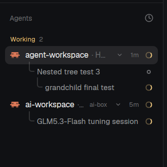

# Agents tree

The Herdr agents list, with Claude Code's in-process subagents shown under the terminal that runs them. Claude Code starts subagents (its Agent tool) inside its own process, so they get no terminal and the shipped `agents` mod never lists them. This mod adds one row per subagent, nested under its parent at any depth, including on remote machines.

This is an interim mod. It exists until there are stable ways to get the same information: the shipped `agents` mod showing `records` (see [herdr-app#627](https://github.com/herdrdev/herdr-app/issues/627)), and a parent id inside Claude Code's OSC 7501 records. Until then it reads Claude Code's own `meta.json` files, which are undocumented and can change in any Claude Code release.

Tested on herdr-app 0.1.13, herdr-core (hc) 0.1.18 and Claude Code 2.1.318. It is a clone of the `agents` mod that ships with Herdr (Apache-2.0); everything except the subagent rows is that mod unchanged.

It runs a program (`sh`, through `exec`, on the terminal's machine) and reads files outside its own folder: `~/.claude/sessions/<pid>.json` and `~/.claude/projects/*/<sessionId>/subagents/agent-*.meta.json`. It writes nothing and makes no network calls.

## What you see

The Agents block of the sidebar, as in the shipped mod: an "Agents" header with the sort button, then agents grouped by priority (Needs you, Done, Working, Idle) or by space.

Under each agent row (30px high), its subagents appear as sub-rows: 26px high, 12.5px text, indented 39px, with tree lines (1.5px, theme `input` color) drawn the same way the shipped mod draws `hc run` sub-agents. A sub-row shows the subagent's title (the Agent tool's description) in the muted text color and its status on the right. A subagent started by another subagent sits one level deeper, under its parent.

## How it behaves

- Working subagent: the spinning `working` spinner (12px, one turn per 900ms).
- Waiting subagent: one that is waiting on its own subagent drops out of Claude Code's records. The mod keeps it as an idle row (a 7px ring), named from its `meta.json` description, while any of its descendants is still listed. Without that row, the child would jump up to the terminal.
- Finished subagents disappear when Claude Code removes their record.
- A subagent's status counts toward its agent's urgency the same way `hc run` sub-agents do, so the folded count and the priority sections reflect it.
- Clicking a subagent row does nothing: there is no terminal to peek at. Clicking the agent row, folding with the chevron or the agent icon, pinning and sorting all work as in the shipped mod.
- The list refreshes about once a second.
- Agents on another machine (`ai-box/t3`) get their subagent rows too; the lookup runs on that machine.

## Built from

- `mods/agents-tree/main.js`, cloned from the shipped `agents` mod with `herdr-app do mod.clone '{"name":"agents","as":"agents-tree"}'`. The sort popup opens `agents-tree` (the clone rewrites that name). Icons come from the shipped `workspace-chrome` mod (`mods/workspace-chrome/*.svg`).
- Rows: `terminals()` returns each terminal's `records` (`{ "<agentId>": { app, state, title } }`) and `foreground` (`{ pid, argv, cwd }`). `poll()` turns every record into a row `{ address: "<terminal>#<agentId>", name, status, rec: true, parent }`.
- Parents: on the first sight of an unknown agent id, `loadMeta()` runs `exec("sh", ["-c", META, "sh", pid], { on: machine })`. `META` reads `sessionId` from `~/.claude/sessions/<pid>.json`, then prints every `~/.claude/projects/*/<sessionId>/subagents/agent-<id>.meta.json` with `grep -H .`. The mod keeps `description` and `parentAgentId` per id. `on` is the address prefix before `/`, or null for this machine.
- `tree(all, addr)` returns the live `hc run` children of `addr` plus the record rows whose `parent` is `addr`, depth first. `subRow()` skips `on_click` for rows with `rec: true`.
- Loop: `cx.spawn` runs `poll()`, `cx.notify()`, `cx.sleep(1000)` forever. The shipped 30 s `cx.timer` stays for the "since" times.
- Layout: a clone of `main` (`herdr-app do layout.clone '{"name":"main","as":"main-tree"}'`) with the `agents` block's `content.mod` set to `agents-tree`.

## Watch out

- `hc ls --json` leaves out `records` and `foreground`; only `hc get <terminal> --json` and the mod's `terminals()` have them. Don't poll `hc` from the mod.
- `herdr-app check` renders the mod in isolation, where `terminals()` is empty, so it can't show subagent rows. Check them in the running app.
- `records` is flat. The parent is only in Claude Code's `meta.json`, which is undocumented. If Claude Code changes that file or the `~/.claude/sessions/<pid>.json` layout, rows still show but all of them sit directly under the terminal.
- The session lookup needs `foreground.pid` to be the `claude` process itself. A wrapper script in front of `claude` breaks nesting the same way.
- Meta is read once per new agent id, not refreshed.
- Edit the clone, not the shipped `agents` mod: Herdr moves edited shipped files aside on the next start.

## Done when

- `herdr-app check mods/agents-tree` passes.
- With `main-tree` shown, start a Claude Code subagent in a herdr terminal: a row with its description and a spinner appears under that agent within about a second, and goes away when it finishes.
- Have that subagent start its own subagent and wait for it: the first one stays as an idle-ring row and the second sits one level below it.
- A Claude Code session on a remote machine shows its subagent rows under its agent.
- Clicking a subagent row opens nothing; clicking the agent row still focuses its pane.
